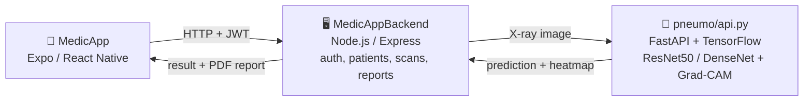

# MedicApp · AI-assisted pneumonia detection

A mobile app for doctors that detects **pneumonia on chest X-rays** using deep learning. The doctor manages their patients, uploads an X-ray from the phone and gets the model's prediction with a **Grad-CAM heatmap** showing which areas of the lung drove the decision, plus a PDF report saved in the patient's history.

The project has two parts:
1. **Model research:** three CNNs (DenseNet, ResNet50, EfficientNet) trained and compared with transfer learning.
2. **Full-stack app:** an Expo (React Native) mobile app, a Node.js/Express backend and a FastAPI service that serves the models.


## Features

**Mobile app (doctor side)**
- Sign up and log in (JWT authentication)
- Doctor profile with medical specialty
- Add patients and view each patient's profile
- Scan or upload a chest X-ray and get an AI prediction
- AI result screen with the Grad-CAM heatmap
- Scan history per patient, with downloadable PDF reports ([sample report](docs/sample-report.pdf))

**AI service**
- REST API built with FastAPI: `POST /predict/{model_name}`, where the model can be `resnet` or `densenet`
- Grad-CAM explanation generated for every prediction

## Architecture



```
├── MedicApp/            Expo mobile app (screens in app/, API calls in services/)
├── MedicAppBackend/     Express API: auth, doctors, specialties, patients, predictions
├── pneumo/              Deep learning: notebooks, training, evaluation, FastAPI service
│   ├── Processing_data.ipynb   preprocessing (resize 224×224, normalisation, splits)
│   ├── balance_data.ipynb      class balancing with SMOTE
│   ├── densenet/  resnet50/  efficent_net/   training + evaluation per model
│   ├── testing_last_phase/     single-image prediction and Grad-CAM
│   ├── api.py                  FastAPI prediction service
│   └── utils.py                preprocessing and Grad-CAM helpers
└── docs/                sample generated report
```

## The models

| Step | What was done |
|---|---|
| Preprocessing | Images resized to 224×224, pixel values normalised to [0, 1], train / validation / test split |
| Class balancing | SMOTE to generate synthetic samples and balance NORMAL vs PNEUMONIA |
| Training | Transfer learning from ImageNet weights, data augmentation (rotation, flip, zoom), custom head (GlobalAveragePooling2D → Dropout → Dense), AdamW optimizer |
| Models compared | **DenseNet**, **ResNet50**, **EfficientNet** |
| Explainability | Grad-CAM heatmaps on the last convolutional layer |

**Results:** DenseNet reached **88% accuracy** on a 640-image test set. Training curves, confusion matrices and classification reports for every model are in the notebooks.

**Dataset:** [Chest X-Ray Images (Pneumonia)](https://www.kaggle.com/datasets/paultimothymooney/chest-xray-pneumonia) from Kaggle, placed in `pneumo/data/chest_xray/`. It is not included in this repository.

## Tech stack

| Part | Technologies |
|---|---|
| Mobile | React Native, Expo, Expo Router |
| Backend | Node.js, Express, JWT, bcrypt |
| AI service | Python, FastAPI, Uvicorn, TensorFlow / Keras |
| ML research | Jupyter, scikit-learn, imbalanced-learn (SMOTE), Matplotlib |

## Run it locally

**1. AI service** (after downloading the models, see above)
```bash
cd pneumo
pip install -r requirements.txt
uvicorn api:app --host 127.0.0.1 --port 8000 --reload
```

**2. Backend**
```bash
cd MedicAppBackend
npm install
cp .env.example .env        # then fill in the values
node scripts/init_db.js     # create the database
npm run dev
```

**3. Mobile app**
```bash
cd MedicApp
npm install
npx expo start
```
In `MedicApp/services/api.js`, set the IP address to your computer's local IP (`ipconfig` on Windows, `ifconfig` on Linux/macOS) so the phone can reach the backend.


